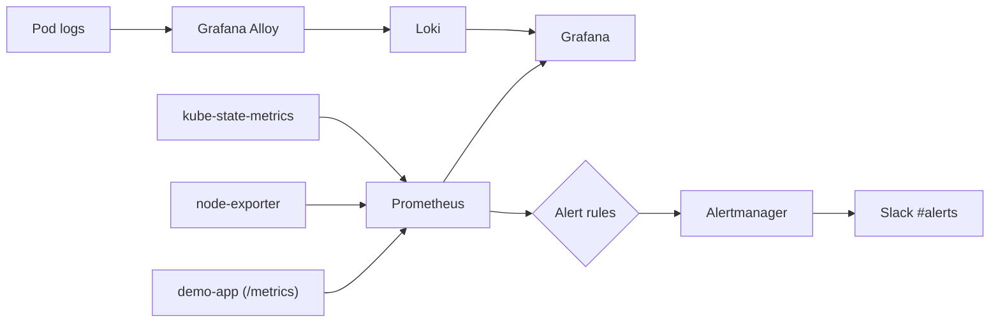
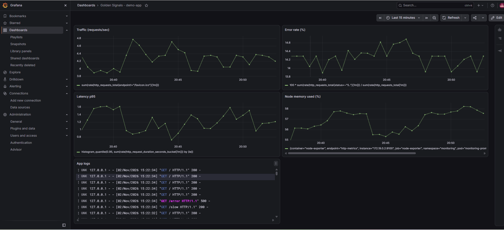
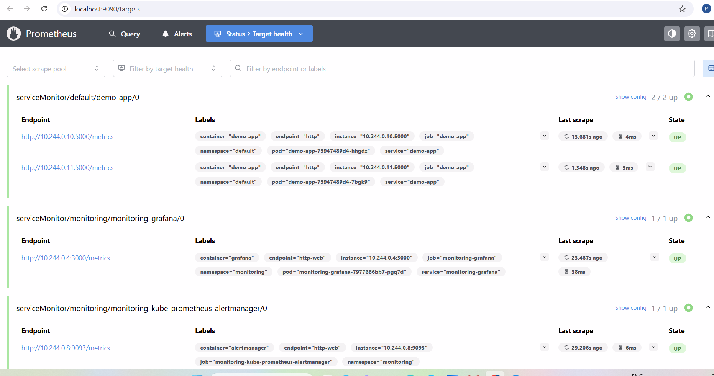
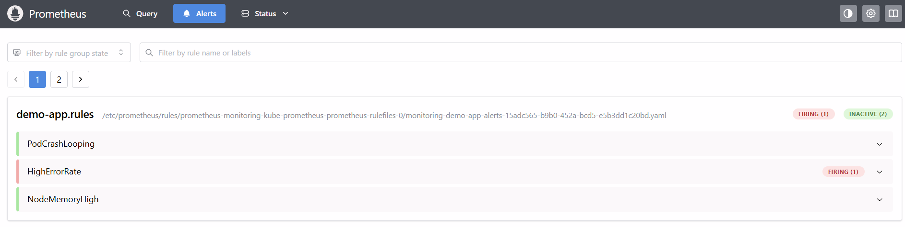
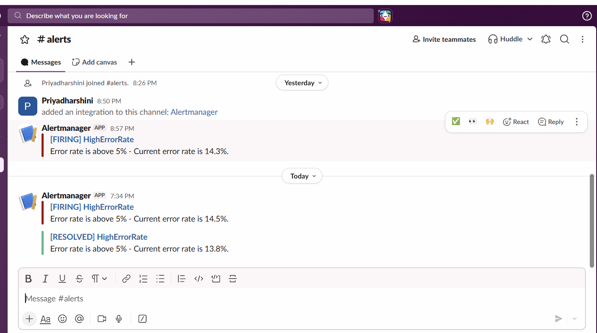
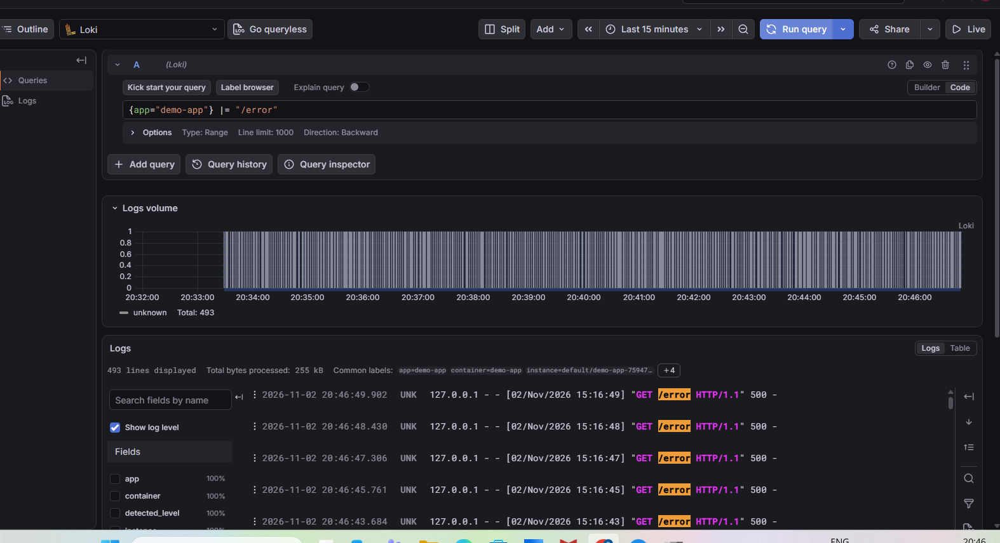

# devops-project-5-monitoring

Monitoring a Kubernetes app with Prometheus, Grafana, Alertmanager and Loki, all managed as code.

## Problem

When an app breaks, users usually notice before the team does. This project makes the cluster and the app report their own health: metrics, dashboards, Slack alerts and searchable logs, so problems are found before users complain.

## Architecture

## Tools used

| Tool | Purpose |
|---|---|
| kind + Docker | Local Kubernetes cluster |
| Helm + kube-prometheus-stack | Prometheus, Grafana, Alertmanager in one install |
| Flask + prometheus_client | Demo app exposing request count and latency at /metrics |
| ServiceMonitor | Tells Prometheus to scrape the app |
| PrometheusRule | Alert rules as code |
| Loki + Grafana Alloy | Central logs (Alloy replaces Promtail, which reached end of life in March 2026) |

## Repo layout

    app/                      Flask app + Dockerfile
    k8s/                      Deployment, Service, ServiceMonitor, Loki datasource
    alerts/rules.yaml         3 alert rules
    helm/                     Helm values (kube-prometheus-stack, Loki, Alloy)
    dashboards/               Grafana dashboard JSON
    screenshots/              Proof that it works

## Screenshots

Golden signals dashboard with live metrics and logs:

Prometheus targets (demo-app up):

Alert firing in Prometheus:

Alert received in Slack (FIRING and RESOLVED):

Error logs in Loki:

## How to run

Needs Docker Desktop, kind, kubectl and Helm.

    kind create cluster --config kind-config.yaml

    helm repo add prometheus-community https://prometheus-community.github.io/helm-charts
    helm repo add grafana-community https://grafana-community.github.io/helm-charts
    helm repo add grafana https://grafana.github.io/helm-charts
    helm repo update

    kubectl create namespace monitoring
    kubectl create secret generic slack-webhook -n monitoring --from-literal=url="<your Slack incoming webhook URL>"

    helm install monitoring prometheus-community/kube-prometheus-stack -n monitoring -f helm/values.yaml

    docker build -t demo-app:v1 app
    kind load docker-image demo-app:v1 --name monitoring
    kubectl apply -f k8s/demo-app.yaml
    kubectl apply -f alerts/rules.yaml

    helm install loki grafana-community/loki -n monitoring -f helm/loki-values.yaml
    helm install alloy grafana/alloy -n monitoring -f helm/alloy-values.yaml
    kubectl apply -f k8s/loki-datasource.yaml

Open the UIs with port-forward (one terminal each):

    kubectl port-forward svc/demo-app 9000:80
    kubectl port-forward -n monitoring svc/monitoring-grafana 3000:80
    kubectl port-forward -n monitoring svc/monitoring-kube-prometheus-prometheus 9090:9090

Grafana is at http://localhost:3000 (demo login admin / admin123, local cluster only). Import `dashboards/golden-signals.json` from Dashboards, New, Import.

Generate traffic (PowerShell):

    while ($true) {
      1..5 | ForEach-Object { Invoke-WebRequest -UseBasicParsing http://localhost:9000/ | Out-Null }
      Invoke-WebRequest -UseBasicParsing http://localhost:9000/slow | Out-Null
      try { Invoke-WebRequest -UseBasicParsing http://localhost:9000/error | Out-Null } catch {}
      Start-Sleep -Milliseconds 500
    }

## Four golden signals

| Signal | Panel | PromQL |
|---|---|---|
| Traffic | Traffic (requests/sec) | sum(rate(http_requests_total[1m])) |
| Errors | Error rate (%) | 100 * sum(rate(http_requests_total{status=~"5.."}[1m])) / sum(rate(http_requests_total[1m])) |
| Latency | Latency p95 | histogram_quantile(0.95, sum(rate(http_request_duration_seconds_bucket[1m])) by (le)) |
| Saturation | Node memory used (%) | 100 * (1 - node_memory_MemAvailable_bytes / node_memory_MemTotal_bytes) |

## Alert list and what to do when each fires

| Alert | Condition | Severity |
|---|---|---|
| PodCrashLooping | A container restarted more than 2 times in 5 minutes | critical |
| HighErrorRate | 5xx responses above 5 percent for 1 minute | warning |
| NodeMemoryHigh | Node memory above 85 percent for 2 minutes | warning |

**PodCrashLooping**
1. `kubectl get pods` to find the restarting pod.
2. `kubectl describe pod <name>` and look at Events and Last State (OOMKilled, image error, failing probe).
3. `kubectl logs <name> --previous` to see why the last run crashed.
4. Fix the cause (memory limit, config, bad image) and redeploy.

**HighErrorRate**
1. Open the Error rate panel on the Grafana dashboard and note when it started.
2. In Grafana Explore (Loki) run `{app="demo-app"} |= " 500 "` to see which endpoint fails.
3. If it began after a deploy: `kubectl rollout undo deployment demo-app`.

**NodeMemoryHigh**
1. Check the Node memory panel to see the trend.
2. In Prometheus run `topk(5, container_memory_working_set_bytes)` to find the biggest consumers.
3. Raise limits, scale down or add capacity.

## Notes

- The Slack webhook URL is stored as a Kubernetes Secret and mounted into Alertmanager. It is not in Git.
- The Grafana password is a demo value for a local cluster only.
- The `for:` duration on each alert avoids alerts for short spikes, which helps against alert fatigue.
- Clean up with `kind delete cluster --name monitoring`.

